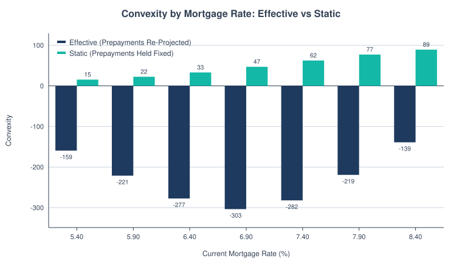
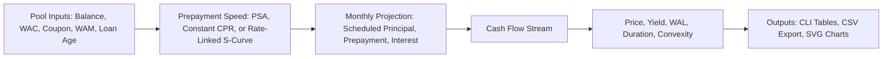
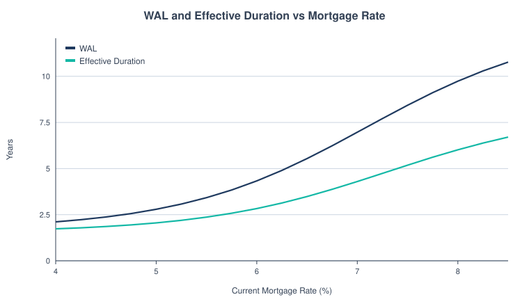
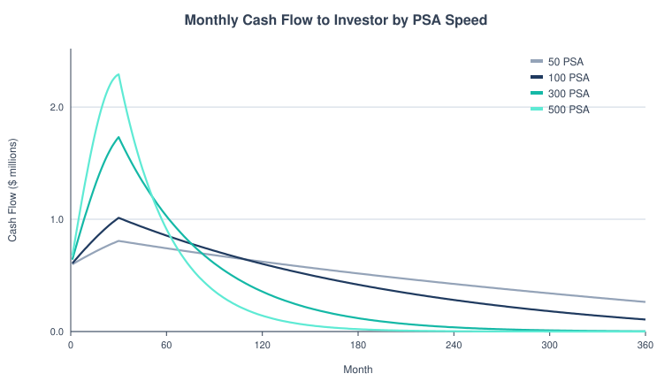
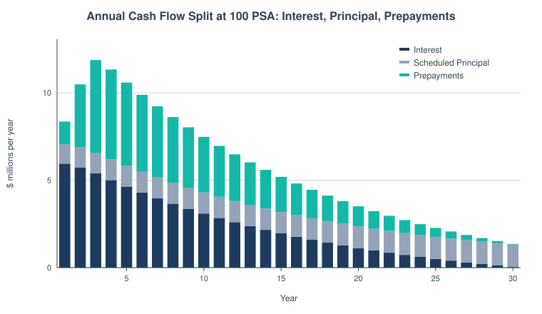
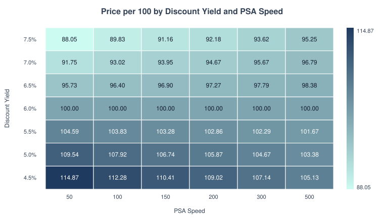
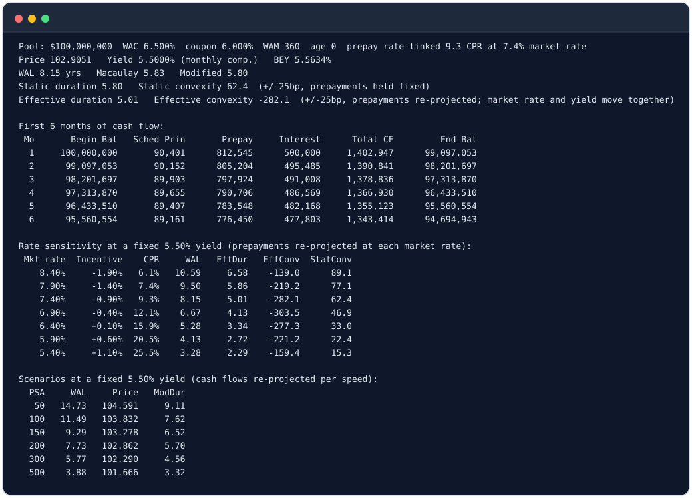

<picture>
  <source media="(prefers-color-scheme: dark)" srcset="docs/banner-dark.svg">
  
</picture>

  

A small, dependency-free Python engine that projects monthly cash flows for an agency
mortgage pass-through, prices it, solves for yield, and measures how sensitive its value and
life are to prepayment speed and to interest rates.

Standard library only (Python 3.9+). No `pip install` needed.

**Contents:** [Hero Chart](#effective-vs-static-convexity) · [Results](#results-at-a-glance) · [How It Works](#how-it-works) · [Quickstart](#quickstart) · [Charts](#charts) · [Sample Output](#sample-output) · [Methodology](#methodology) · [Tranche Waterfall](#tranche-waterfall) · [Optional Matplotlib Charts](#optional-matplotlib-charts) · [Skills](#skills-shown) · [Limitations](#limitations) · [Project Layout](#project-layout) · [Validation](#validation-against-sifma) · [Data Sources](#data-sources) · [License](#license) · [Glossary](#glossary)

<a id="effective-vs-static-convexity"></a>

<picture>
  <source media="(prefers-color-scheme: dark)" srcset="docs/convexity_bars-dark.svg">
  
</picture>

*Effective convexity (navy) re-projects prepayments at each rate, so it is negative from 5.40% to 8.40%, between -139 and -304 in this run. Static convexity (teal) holds the 7.40% cash flows fixed and stays positive.*

## Results at a Glance

All figures come from running the CLI on the default $100mm pool (6.50% WAC, 6.00% coupon, 360 months, 5.50% discount yield).

| Measure | Value | Command |
|---|---|---|
| WAL at 100 PSA | 11.49 years | `python3 cli.py` |
| Price at 100 PSA | 103.832 per 100 | `python3 cli.py` |
| Effective vs Static Convexity at a 7.40% Market Rate | -282.1 vs +62.4 | `python3 cli.py --market-rate 7.40 --yield 5.5` |
| Effective vs Static Duration at a 7.40% Market Rate | 5.01 vs 5.80 years | same |
| WAL Across Mortgage Rates 5.40% to 8.40% | 3.28 to 10.59 years | same (rate sensitivity table) |
| WAL at 7.40% with Burnout 2 | 8.15 to 11.32 years | `python3 cli.py --market-rate 7.40 --yield 5.5 --burnout 2` |

## How It Works



- Projects a pass-through: beginning balance, scheduled principal, prepayment, interest to the investor, total cash flow, ending balance.
- Accepts a constant CPR, a PSA speed, or a **rate-linked** speed driven by a refinancing S-curve.
- Optional **burnout**: prepayment speed fades as the fastest prepayers leave the pool.
- Prices from a yield and solves yield from a price (bisection).
- Reports WAL, Macaulay and modified duration, **static** duration and convexity (cash flows held fixed), and **effective** duration and convexity (cash flows re-projected under each rate shock).
- Runs a scenario table across PSA speeds and a rate-sensitivity table across mortgage rates to show extension and contraction risk.

## Quickstart

```bash
git clone https://github.com/builtby-hari/MBSCashFlowModel.git && cd MBSCashFlowModel && python3 cli.py --market-rate 7.40 --yield 5.5
```

```bash
python3 cli.py                                  # 100mm, 6.5% WAC, 6.0% coupon, 360 WAM, 100 PSA, 5.5% yield
python3 cli.py --psa 250 --yield 5.0
python3 cli.py --cpr 8 --price 102.5            # solve the yield from a price
python3 cli.py --wam 300 --age 60 --wac 5 --coupon 4.5 --csv cashflows.csv
python3 cli.py --market-rate 7.4 --yield 5.5    # rate-linked prepayments, effective duration/convexity
python3 cli.py --cpr 20 --burnout 2             # burnout on a constant 20% CPR
python3 cli.py --market-rate 7.4 --yield 5.5 --oas --paths 500 --vol 100 --seed 1   # OAS, Z-spread, option cost
python3 cli.py --waterfall sample_deal.toml --grid   # tranche waterfall, stress grid, break-even CDR
python3 -m unittest discover -v                 # run the tests
python3 -m mbs.charts                           # regenerate every SVG in docs/ (light and dark)
```

Use `python3 cli.py -h` for all options.

## Charts

Every chart is hand-written SVG from `mbs/charts.py`, with a light and a dark version. Regenerate them with `python3 -m mbs.charts`.

<picture>
  <source media="(prefers-color-scheme: dark)" srcset="docs/wal_duration_vs_rate-dark.svg">
  
</picture>

*WAL and effective duration versus the current mortgage rate, with prepayments re-projected at each rate and a 5.50% discount yield. Both lengthen as rates rise because borrowers stop refinancing.*

<picture>
  <source media="(prefers-color-scheme: dark)" srcset="docs/cashflow_profile_by_psa-dark.svg">
  
</picture>

*Monthly cash flow to the investor at 50, 100, 300 and 500 PSA. Faster speeds start higher because they return principal early, then fall below the slower curves: 500 PSA drops under 300 PSA around month 52, 300 PSA under 100 PSA around month 76, and 100 PSA under 50 PSA around month 110.*

<picture>
  <source media="(prefers-color-scheme: dark)" srcset="docs/cashflow_components_100psa-dark.svg">
  
</picture>

*Annual interest (navy), scheduled principal (grey) and prepayments (teal) at 100 PSA. Interest is the largest slice in years 1 and 2. Prepayments peak in year 3 and overtake interest from year 4 on, and all three shrink as the balance pays down.*

<picture>
  <source media="(prefers-color-scheme: dark)" srcset="docs/price_heatmap-dark.svg">
  
</picture>

*Price per 100 by discount yield (rows) and PSA speed (columns). The 6.00% row is exactly par because it equals the coupon. On a premium bond (4.50% row) faster prepayment lowers price, and on a discount bond (7.50% row) it raises price.*

## Sample Output

<picture>
  <source media="(prefers-color-scheme: dark)" srcset="docs/sample-output-dark.svg">
  
</picture>

<details>
<summary>Full output</summary>

```
$ python3 cli.py --market-rate 7.40 --yield 5.5
Pool: $100,000,000  WAC 6.500%  coupon 6.000%  WAM 360  age 0  prepay rate-linked 9.3 CPR at 7.4% market rate
Price 102.9051   Yield 5.5000% (monthly comp.)   BEY 5.5634%
WAL 8.15 yrs   Macaulay 5.83   Modified 5.80
Static duration 5.80   Static convexity 62.4  (+/-25bp, prepayments held fixed)
Effective duration 5.01   Effective convexity -282.1  (+/-25bp, prepayments re-projected; market rate and yield move together)

First 6 months of cash flow:
 Mo       Begin Bal   Sched Prin       Prepay     Interest      Total CF         End Bal
  1     100,000,000       90,401      812,545      500,000     1,402,947      99,097,053
  2      99,097,053       90,152      805,204      495,485     1,390,841      98,201,697
  3      98,201,697       89,903      797,924      491,008     1,378,836      97,313,870
  4      97,313,870       89,655      790,706      486,569     1,366,930      96,433,510
  5      96,433,510       89,407      783,548      482,168     1,355,123      95,560,554
  6      95,560,554       89,161      776,450      477,803     1,343,414      94,694,943

Rate sensitivity at a fixed 5.50% yield (prepayments re-projected at each market rate):
 Mkt rate  Incentive    CPR     WAL   EffDur   EffConv  StatConv
    8.40%     -1.90%   6.1%   10.59     6.58    -139.0      89.1
    7.90%     -1.40%   7.4%    9.50     5.86    -219.2      77.1
    7.40%     -0.90%   9.3%    8.15     5.01    -282.1      62.4
    6.90%     -0.40%  12.1%    6.67     4.13    -303.5      46.9
    6.40%     +0.10%  15.9%    5.28     3.34    -277.3      33.0
    5.90%     +0.60%  20.5%    4.13     2.72    -221.2      22.4
    5.40%     +1.10%  25.5%    3.28     2.29    -159.4      15.3

Scenarios at a fixed 5.50% yield (cash flows re-projected per speed):
  PSA     WAL     Price   ModDur
   50   14.73   104.591     9.11
  100   11.49   103.832     7.62
  150    9.29   103.278     6.52
  200    7.73   102.862     5.70
  300    5.77   102.290     4.56
  500    3.88   101.666     3.32
```

</details>

<details>
<summary>Default Run (100 PSA, No Rate Link)</summary>

```
$ python3 cli.py
Pool: $100,000,000  WAC 6.500%  coupon 6.000%  WAM 360  age 0  prepay 100 PSA
Price 103.8321   Yield 5.5000% (monthly comp.)   BEY 5.5634%
WAL 11.49 yrs   Macaulay 7.65   Modified 7.62
Static duration 7.62   Static convexity 97.4  (+/-25bp, prepayments held fixed)

First 6 months of cash flow:
 Mo       Begin Bal   Sched Prin       Prepay     Interest      Total CF         End Bal
  1     100,000,000       90,401       16,667      500,000       607,068      99,892,932
  2      99,892,932       90,876       33,328      499,465       623,669      99,768,727
  3      99,768,727       91,338       49,976      498,844       640,158      99,627,414
  4      99,627,414       91,786       66,602      498,137       656,525      99,469,026
  5      99,469,026       92,222       83,196      497,345       672,763      99,293,608
  6      99,293,608       92,644       99,751      496,468       688,862      99,101,213

Scenarios at a fixed 5.50% yield (cash flows re-projected per speed):
  PSA     WAL     Price   ModDur
   50   14.73   104.591     9.11
  100   11.49   103.832     7.62
  150    9.29   103.278     6.52
  200    7.73   102.862     5.70
  300    5.77   102.290     4.56
  500    3.88   101.666     3.32
```

</details>

## Methodology

**Why it matters.** A mortgage borrower can repay early at no penalty, so an MBS investor is short a prepayment option. When rates fall, borrowers refinance and principal comes back fast, which shortens the bond just when reinvestment yields are low. When rates rise, prepayments slow and the bond extends. Prepayment speed therefore drives WAL, duration, and price, and any MBS valuation starts with a defensible cash flow projection. This project builds that foundation.

Let $B$ be the beginning balance, $\text{WAC}$ the gross coupon, $c$ the net pass-through coupon, $n$ the remaining months, and $r = \text{WAC}/12$.

| Item | Formula |
|---|---|
| Scheduled payment | $\text{PMT} = \dfrac{B\,r}{1-(1+r)^{-n}}$, recomputed each month on the current balance and remaining term |
| Scheduled principal | $\text{PMT} - B\,r$ |
| SMM from CPR | $\text{SMM} = 1-(1-\text{CPR})^{1/12}$ |
| Prepayment | $\text{SMM}\,(B - \text{scheduled principal})$ |
| Investor interest | $B\,c/12$ (WAC minus servicing and g-fee stays with servicer and guarantor) |
| PSA | $\text{CPR}(\text{age}) = 6\%\cdot\min(\text{age},30)/30\cdot \text{speed}/100$, so 100 PSA ramps 0.2% CPR per month to 6% at month 30 |
| Price | $P = 100\,\sum_t \dfrac{CF_t}{(1+y/12)^t}\Big/ B$ |
| WAL | $\dfrac{\sum_t (t/12)\,\text{Principal}_t}{\sum_t \text{Principal}_t}$ |
| Macaulay duration | $\dfrac{\sum_t (t/12)\,PV(CF_t)}{\sum_t PV(CF_t)}$ |
| Modified duration | $\text{Macaulay}/(1+y/12)$ |
| Static duration | $\dfrac{P_- - P_+}{2\,P_0\,\Delta y}$, cash flows held fixed |
| Static convexity | $\dfrac{P_- + P_+ - 2P_0}{P_0\,\Delta y^2}$, cash flows held fixed |
| Refinancing S-curve | $\text{CPR} = \text{floor} + \dfrac{\text{cap}-\text{floor}}{1+e^{-k(\text{WAC}-\text{market rate}-\text{midpoint})}}$, floor 4%, cap 45%, midpoint 100bp, $k = 100$ |
| Burnout | $\text{CPR}_t = \text{CPR}\cdot e^{-b\,\sum \text{prepayments}/B_0}$ |
| Effective duration / convexity | the same formulas, but the market rate and the yield both move by $\pm\Delta y$ and the cash flows are re-projected at each shocked rate |

**Yield convention.** $y$ is a nominal annual yield compounded monthly, $(1+y/12)^{-t}$. Settlement is at the start of month 1: no accrued interest and no 24/54-day payment delay. Price is per 100 of current balance. The output also shows the semiannual bond-equivalent yield, $\text{BEY} = 2\left[(1+y/12)^6 - 1\right]$, for comparison with Treasuries.

**Rate-linked prepayments.** `--market-rate 7.4` replaces the PSA assumption with a refinancing S-curve driven by the pool's incentive (WAC minus the current mortgage rate). Each rate shock then re-projects the cash flows, so the prepayment response is included. 7.40% was the Freddie Mac 30-year rate (FRED `MORTGAGE30US`) for the week of 2026-10-15.

Static convexity is positive because it holds prepayments fixed. Effective convexity is negative across this range: when rates fall, borrowers refinance and the pool pays back at par, which caps the price gain; when rates rise, prepayments slow and the pool extends. Effective convexity is most negative near the money and weakens as the pool goes deeper in the money.

Burnout (`--burnout 2`) lowers prepayment speed as the pool pays down. At the same 7.40% market rate it stretches WAL from 8.15 to 11.32 years and moves effective convexity to -134.5. The size of that effect depends on the assumed burnout factor, so treat it as a demonstration of the mechanism.

## OAS

**Plain English.** Z-spread discounts one fixed cash flow stream. OAS discounts the cash flows from many simulated rate paths, and the borrower prepays differently on each path. The gap, Z-spread minus OAS, is the cost of the borrower's prepayment option, quoted in spread.

```bash
python3 cli.py --market-rate 7.40 --yield 5.5 --oas --paths 500 --vol 100 --seed 1
```

```
OAS (500 antithetic paths, vol 100bp, seed 1, illustrative curve)
OAS -3.8bp   Z-spread 71.9bp   Option cost 75.6bp
OAS duration 4.41   OAS convexity -126.2  (+/-25bp curve shift, OAS held fixed)
```

The same pool at 50bp and 150bp of volatility gives option costs of 25.5bp and 131.2bp. More volatility makes the option worth more, so OAS falls.

**Method** (code in `mbs/oas.py`).

1. **Short rate.** Ho-Lee (Ho and Lee 1986; Hull, *Options, Futures and Other Derivatives*), $r(t) = f(0,t) + \sigma^2 t^2/2 + \sigma W(t)$, stepped monthly. $f(0,t)$ is the forward implied by the spot curve and $\sigma$ is a normal volatility in basis points per year (`--vol`, default 100). Ho-Lee can produce negative rates at high volatility.
2. **Calibration.** Each month the simulated discount factors are scaled so their path average equals the curve discount factor. At zero spread the model then reprices any fixed cash flow to the curve exactly, for any path count.
3. **Mortgage rate.** The simulated 10-year Ho-Lee zero yield plus a constant spread. The spread is set so the path starts at `--market-rate`, and it has no volatility of its own.
4. **Prepayments.** Each month's CPR comes from the refinancing S-curve at that path's mortgage rate, then optional burnout (`--burnout`). Prepayments are path-dependent.
5. **Paths.** Paths are antithetic (every draw is paired with its mirror) and seeded (`--seed`). `--paths` must be even.
6. **Solve.** OAS is the constant spread $s$ that makes the average present value equal the price, with each cash flow discounted by the path factor times $\left[\frac{1+(\text{spot}_t+s)/12}{1+\text{spot}_t/12}\right]^{-t}$. At zero volatility this is the Z-spread.
7. **OAS duration and convexity.** Shift the spot curve by $\pm$ `--shock` bp, re-simulate with the same seed and the same mortgage spread, reprice at the base OAS, and apply the usual finite-difference formulas.

**Simplifications.**

- The spot curve is an illustrative input (`default_spot`: 4.0% rising toward 5.0%), not market data, and the CLI has no flag to change it. Pass your own `spot` function to `oas_analysis()` in Python.
- One factor: the mortgage rate moves with the short rate through Ho-Lee, so there is no curve twist and no mortgage spread volatility.
- The Z-spread uses the static cash flows at `--market-rate`, while the OAS paths start from forward-implied mortgage rates. So at zero volatility with rate-sensitive prepayments the two differ slightly. With rate-insensitive prepayments they match.
- Prepayment parameters are the same illustrative S-curve and burnout as above. Mean Monte Carlo error at a few hundred paths is several basis points of OAS, so raise `--paths` for stable numbers.
- With the default 100bp volatility the sample premium pool has a slightly negative OAS. That reflects the illustrative inputs, not a view on any real security.

## Tranche Waterfall

**Plain English.** A securitization splits one pool into classes. The senior class (A) is paid first and loses last, the mezzanine (M) and subordinate (B) classes absorb losses first and earn more coupon for it, and the leftover cash goes to the residual holder. `mbs/waterfall.py` runs the default pool through that structure month by month and shows who gets paid, who takes a loss, and how bad the pool has to get before each class does.

**Collateral.** Prepayments reuse the existing CPR and PSA code. Each month the constant default rate (CDR) converts to a monthly default rate the same way CPR converts to SMM, and that share of the performing balance defaults. A defaulted loan pays no interest and no principal, so defaults cut both the balance and the interest that month. After the recovery lag, the loan is liquidated: the recovery (1 minus severity) arrives as principal cash and the severity share is the realized loss. With CDR at zero the collateral is exactly `project_cashflows`.

**Deal rules.**

1. Interest: each class is due its balance times its coupon over 12, paid pro rata if collections fall short. Unpaid interest is not carried forward.
2. Excess spread (interest collected minus interest paid) joins principal collections and is captured to pay notes down toward the overcollateralization (OC) target, where notes equal collateral (performing plus defaulted but unliquidated) minus the target. Cash above that is released to the residual.
3. Principal is paid pro rata by balance, or strictly A then M then B if `principal = "sequential"` or if cumulative realized loss reaches the trigger. The trigger is the shifting-interest switch: once tripped, junior classes stop receiving principal and the senior class is protected.
4. If notes still exceed collateral after payment, the gap is written down bottom up (B, then M, then A). Written-down principal is never reinstated.

**Reading the output.** Each class shows WAL, principal window, loss as a percent of original balance, whether it takes a writedown, and yield at an input price (100 unless the class sets `price`). The break-even CDR is the lowest CDR, at the chosen severity, where the class loss first exceeds 0.01% of its balance, found by bisection. The grid shows class loss across CDR and severity.

```bash
python3 cli.py --waterfall sample_deal.toml --cdr 4 --severity 60 --grid   # add --psa or --cpr for prepayments, --lag for the recovery lag
```

`sample_deal.toml` is an illustrative structure for demonstration, not a real transaction. Every balance, coupon, trigger and stress level is an input. Reading TOML needs Python 3.11 or later; on older versions build a `Deal` in code.

<details>
<summary>Sample output</summary>

```
$ python3 cli.py --waterfall sample_deal.toml --cdr 4 --severity 60 --grid
Deal: $100,000,000 pool  WAC 7.000%  net 6.500%  WAM 360  prepay 100 PSA
Stress: CDR 4%  severity 60%  lag 6 months  OC target $2,000,000  trigger 3% cumulative loss
Principal rule: pro rata, sequential from month 22

Class        Balance    Cpn    WAL     Window  Loss %  Writedown   Price   Yield
    A     80,000,000  5.25%   7.97      1-269    0.00         no  100.00  5.250%
    M     12,000,000  6.00%  21.33      1-366   51.35        yes  100.00  3.273%
    B      6,000,000  7.00%   1.12       1-21   91.38        yes  100.00 -39.498%
Residual / OC cash: $540,080

Break-even CDR at 60% severity (class loss first exceeds 0.01%):
  A: 5.37%
  M: 2.59%
  B: 1.84%

Class A loss % of original balance (rows CDR, columns severity):
   CDR     20%     40%     60%     80%    100%
    1%    0.00    0.00    0.00    0.00    0.00
    2%    0.00    0.00    0.00    0.00    0.00
    4%    0.00    0.00    0.00    0.96    8.85
    6%    0.00    0.00    2.63   13.18   24.17
    8%    0.00    0.00   10.06   23.04   36.31
   10%    0.00    1.94   16.07   30.90   45.86

Class M loss % of original balance (rows CDR, columns severity):
   CDR     20%     40%     60%     80%    100%
    1%    0.00    0.00    0.00    0.00    0.00
    2%    0.00    0.00    0.00    2.67   30.30
    4%    0.00    2.42   51.35   94.49   96.08
    6%    0.00   44.92   93.76   96.22   97.64
    8%    1.81   78.81   95.10   97.01   98.02
   10%   17.34   92.64   96.01   97.37   98.36

Class B loss % of original balance (rows CDR, columns severity):
   CDR     20%     40%     60%     80%    100%
    1%    0.00    0.00    0.00    0.00    0.00
    2%    0.00    0.00   30.42   87.87   91.55
    4%    0.00   84.60   91.38   94.49   96.08
    6%   36.56   89.11   93.76   96.22   97.64
    8%   77.27   91.06   95.10   97.01   98.02
   10%   81.03   92.64   96.01   97.37   98.36
```

</details>

**Simplifications.** The model uses fixed-rate classes with no fees or servicer advances, does not carry interest shortfalls forward, uses one cumulative loss trigger (no delinquency trigger), a dollar OC target with no step-down, and one CDR and severity for the whole life. Treat results as a teaching model, not a rating-agency run.

## Optional Matplotlib Charts

The core package is standard-library only. `plots_mpl.py` is an optional extra that plots the same data with matplotlib and writes PNGs to `docs/mpl/`.

```bash
pip install -r requirements-extra.txt
python3 plots_mpl.py
```

Without matplotlib installed, the script exits with a short message. The matplotlib tests are skipped in that case.

## Skills Shown

Python · Fixed income · Mortgage prepayment modeling · Data visualization · Unit testing

## Limitations

- OAS is illustrative. OAS uses a one-factor Ho-Lee model on an illustrative curve with a constant mortgage spread (see the OAS section). It shows the method and the option-cost mechanism, not a desk-ready number.
- Solver range. `yield_from_price()`, `z_spread()` and the OAS solver bisect over -50% to 100% (-0.5 to 1.0 decimal). A price outside that bracket raises `ValueError`; results are never clamped.
- Illustrative prepayment curve. The S-curve parameters (floor 4%, cap 45%, midpoint 100bp, steepness 100) and the burnout factor are assumptions chosen for shape. They are not calibrated to agency prepayment data, so the effective measures show the mechanism, not a forecast.
- Burnout is simplified. It scales the whole CPR, including baseline turnover. Real models apply burnout to the refinancing component only. The rate-linked CPR is constant in loan age (no seasoning in the rate response).
- Prepayment speed does not depend on seasonality or loan characteristics.
- No credit or default modeling (agency guarantee assumed; no delinquency or buyout behavior).
- The pool uses a single WAC, with no accrued interest. The default analytics assume no payment delay; `bey_price`, `bey_risk` and `wal(..., delay_days=)` accept one (SIFMA 30/360 bond-equivalent convention).
- Yield and spread solvers search only -50% to 100%; a price needing a rate outside that range raises an error.
- The cash flows and charts use one synthetic $100mm pool. No market data is loaded.

**Next steps**

1. Mean-reverting short rate (Hull-White) calibrated to a swaption or cap volatility surface, and a two-factor mortgage rate.
2. Calibrate the S-curve and burnout to historical prepayment data, and add seasonality.
3. Pull historical mortgage rates (FRED, e.g. `MORTGAGE30US`) to back-test projected speeds.

## Project Layout

```
mbs/prepay.py                 CPR, SMM, PSA ramp
mbs/cashflows.py              Pool, scheduled payment, monthly projection
mbs/analytics.py              price, yield, WAL, duration, static convexity
mbs/ratelinked.py             refinancing S-curve, rate-linked projection, effective duration/convexity
mbs/oas.py                    Ho-Lee Monte Carlo paths, OAS, option cost, OAS duration/convexity
mbs/waterfall.py              defaults and losses, tranche waterfall, OC and trigger, loss grid, break-even CDR
sample_deal.toml              illustrative deal for the waterfall CLI
mbs/charts.py                 hand-written SVG charts (light and dark), regenerated by python3 -m mbs.charts
plots_mpl.py                  optional matplotlib versions of the main charts (PNG)
requirements-extra.txt        optional extra: matplotlib
cli.py                        command line interface
docs/                         SVG charts, banner and sample output; docs/mpl/ holds the optional PNGs
tests/                        unittest suite
```

## Validation Against SIFMA

The model reproduces the published numbers in the SIFMA (Bond Market Association, 1999) Uniform Practices chapter *Standard Formulas for the Analysis of Mortgage-Backed Securities*: the first-month cash flow split (amortization 0.00049188, prepayment 0.00025022, interest 0.00750000), the prepayment-speed example (SMM 0.435270%, CPR 5.1000%, 150% PSA, pool factor 0.85150625 -> 0.84732282), CF1-CF3 and CF360 of a 9.5%/9.0% 150 PSA pool, Average Life 9.77844, yield 9.10675% pricing at par, Duration 5.73147, Modified Duration 5.48186 and Cash-Flow Convexity 54.4326 (these use the bond-equivalent helpers `bey_price`/`bey_risk` with a 14-day payment delay). Source: https://www.sifma.org/wp-content/uploads/2017/08/chsf.pdf

## Data Sources

No external data files are loaded. Rates are inputs. The 7.40% example rate is the Freddie Mac 30-year fixed rate (FRED `MORTGAGE30US`) for the week of 2026-10-15, as noted above.

## License

MIT. See `LICENSE`.

## Glossary

| Term | Plain-English Meaning |
|---|---|
| Basis Point (bp) | One hundredth of a percentage point, so 100 bp equals 1 percentage point, like a penny is a hundredth of a dollar. |
| BEY (Bond-Equivalent Yield) | A bond's yield restated as a twice-a-year rate so it can be compared with Treasury quotes. |
| Burnout | The slowing of prepayments over time as the most eager borrowers have already left, like a fruit bowl where the ripest fruit is picked first. |
| Convexity | How much a bond's price-versus-rate curve bends, which corrects a straight-line price estimate for big rate moves. |
| Coupon | The fixed interest rate a bond pays each year, as a percent of its face value. |
| CPR (Constant Prepayment Rate) | The share of a loan pool's remaining balance that borrowers pay off early in a year. |
| Effective Duration | A duration measure that re-runs the cash flows at each rate move, so early repayments adjust too; it estimates the percent price change for a one-point rate move. |
| FRED | The Federal Reserve Bank of St. Louis's free database of economic data, including interest rate series. |
| G-Fee (Guarantee Fee) | The fee taken out of each loan's interest to insure investors against default, so investors receive less than borrowers pay. |
| Negative Convexity | A bend that works against the investor: when rates fall, the price gain is capped because borrowers refinance, like a bet with a capped upside. |
| OAS (Option-Adjusted Spread) | The extra yield over Treasuries after pricing in the value of borrowers' right to repay early; the `--oas` option estimates it by Monte Carlo. |
| Par | Face value; a price of 100 means the bond costs exactly what it pays back, while above 100 is a premium and below 100 is a discount. |
| Option Cost | Z-spread minus OAS: the spread given up because borrowers can repay early. |
| Pass-Through | A security that collects monthly mortgage payments and passes them along to investors, like a relay where each runner hands the baton on. |
| Prepayment | Paying off all or part of a loan before its scheduled due date, like paying a credit card bill early. |
| PSA (Prepayment Speed) | A standard industry benchmark for how fast borrowers prepay, where 100 PSA is the usual baseline that ramps up over 30 months. |
| Refinancing | Taking out a new mortgage at a better rate to pay off the old one, like switching to a cheaper phone plan. |
| S-Curve | A curve that is flat at both ends and steep in the middle, like a stretched letter S; here it maps how rates drive refinancing. |
| Seasoning | How long a loan has existed, measured in months since it started. |
| SMM (Single Monthly Mortality) | The share of a loan pool's balance paid off early in one month, the monthly version of CPR. |
| Treasury | A bond issued by the US government, used as the benchmark for low-risk interest rates. |
| WAC (Weighted Average Coupon) | The average interest rate on the pool's loans, weighted by balance, before fees are taken out. |
| WAL (Weighted Average Life) | The average number of years until each dollar of principal comes back, weighted by how much arrives when. |
| WAM (Weighted Average Maturity) | The average number of months left until the pool's loans are fully repaid. |
| Yield | The annual return an investor earns by buying at today's price and holding until the end. |

---

Built by Hari Saravanan · [LinkedIn](https://www.linkedin.com/in/srihari-saravanan)
